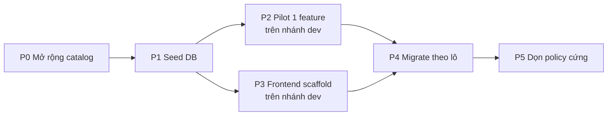

# Hướng dẫn Đấu nối Phân quyền Động (Dynamic RBAC) — GearGo_Webapp — **v2**

> **Tóm tắt**: Lõi RBAC động đã dựng xong (handler + policy provider + service + cache 30s + version bump).
> Hệ vẫn đang chặn API bằng Role cứng (`AdminOnly` / `StaffOrAdmin`) và render tab/nút tĩnh. v2 này bổ sung
> những điểm v1 **bỏ sót** để migrate an toàn, không bị 403 hàng loạt sau khi deploy.

---

## 0. Tóm tắt điểm bổ sung so với v1

| # | v1 bỏ qua | v2 bổ sung |
|---|---|---|
| 1 | Magic string mã quyền | Bắt buộc dùng `DomainConstants.Permissions.*` |
| 2 | Catalog thiếu quyền | Bảng gap analysis: 23 mã trong catalog vs **31 controller có policy cứng** (trên tổng **38 controller** — xem §1.4) — thiếu ~20 mã |
| 3 | Seed quyền `NhanVien` | Bắt buộc mở rộng `DefaultStaff` + migration DB trước khi đổi controller |
| 4 | Attribute theo controller | Attribute **theo action** (Xem/Tao/CapNhat/Xoa tách riêng) |
| 5 | Frontend `hasPerm` không định nghĩa | Tạo `PermissionsContext` + `useHasPerm` + `<Can perm="…">` |
| 6 | Ẩn tab là đủ | Thêm guard **trong tab** (nút/thao tác), `DashboardLayout` nhận `navItems` đã lọc |
| 7 | Không nhắc UC1.10 | UI "Phân quyền riêng theo nhân viên" (backend đã sẵn, frontend chưa có) |
| 8 | Không nhắc refresh | Refetch `/api/auth/quyen-cua-toi` khi visibility change + sau mỗi 403 + sau khi admin đổi |
| 9 | Rollout chung chung | 6 pha có rollback & smoke test giữa mỗi pha |
| 10 | Không nhắc `[Authorize]` trần | Có controller chỉ có `[Authorize]` mà không policy → vẫn phải audit riêng |
| 11 | Không nhắc `QUYEN_DA_THAY_DOI` | Frontend phải bắt mã này ở global interceptor → logout + thông báo |
| 12 | Không nhắc cache đa instance | `IMemoryCache` cục bộ; version-check cứu được role nhưng *user override* bị stale 30s |

---

## 1. Thực trạng xác minh (tháng 2026-11)

### 1.1 Backend — lõi RBAC động đã có
| File | Vai trò |
|---|---|
| `backend/Helpers/Authorization/PermissionAuthorization.cs` | `PermissionRequirement`, `PermissionAuthorizationHandler`, `PermissionPolicyProvider` (sinh policy `perm:<Ma>` runtime), `[RequirePermission]` |
| `backend/Services/Interfaces/HeThong/IPermissionService.cs` | Contract: role perms, user override perms, version, cache |
| `backend/Services/Implements/HeThong/PermissionService.cs` + `.NhanVienVaCache.cs` | Impl: `IMemoryCache` TTL 30s, `CacheEntry(Version, HashSet)` version-check, `UserCacheEntry(HasOverride, Quyen)` TTL 30s **không version-check** |
| `backend/Program.cs:177-178` | Đăng ký handler + provider (Singleton) |
| `backend/Program.cs:88-124` | `OnTokenValidated` sync role từ DB, set `QuyenDaThayDoi = true` khi khác |
| `backend/Program.cs:126-138` | `OnForbidden` trả mã `QUYEN_DA_THAY_DOI` cho FE |

### 1.2 Backend — còn hardcode
- **74 attribute** `[Authorize(Policy = "AdminOnly" | "StaffOrAdmin")]` trên **31 controller có policy cứng** (trong tổng ≈38 controller — xem §1.4; phần còn lại là public/anonymous/customer).
- **0 attribute** `[RequirePermission]` đang được dùng.
- Một số controller chỉ có `[Authorize]` ở class + policy ở action lẻ (vd `Staff/PhuPhiController.cs`). → Không grep đơn giản bằng chuỗi `Policy =` được, phải đọc từng file.

### 1.3 Frontend — UI phân quyền đã có nhưng chưa đấu nối
- `frontend/src/features/permissions.tsx`: `usePermissions()` + `PermissionsTab`.
- `frontend/src/views/AdminView.tsx:40-58`: tabs khai báo tĩnh, không có field `perm`, không lọc.
- `frontend/src/views/StaffView.tsx:22-27`: y hệt.
- Chưa có global 403 interceptor, chưa có refetch quyền khi focus tab.

### 1.4 Gap catalog quyền — **nghiêm trọng**
`DomainConstants.Permissions.All` hiện có **23 mã** cho 9 nhóm: `DonThue, SanPham, DanhMuc, KhuyenMai, ChinhSach, BaoCao, TaiKhoan, NhanVien, PhanQuyen`.

Codebase thực tế (verify ls): **15 Admin + 17 Staff + 3 Customer + 3 Public ≈ 38 controller**. Trong đó Admin có 3 cặp "cặp `QuanTri*`" (`QuanTriKhuyenMaiController`, `QuanTriTaiKhoanController`, `QuanTriBaoCaoTaiChinhController`) — dùng chung mã quyền với controller cặp, xem §7. Thiếu catalog cho:

| Controller | Mã quyền cần thêm (gợi ý) |
|---|---|
| `Staff/PhuPhiController` | `PhuPhi.Xem`, `PhuPhi.Tao`, `PhuPhi.Duyet`, `PhuPhi.Huy` |
| `Staff/DoiSoatController` | `DoiSoat.Xem`, `DoiSoat.Chot` |
| `Staff/QuaHanController` | `QuaHan.Xem`, `QuaHan.XuLy` |
| `Staff/VongDoiThietBiController` | `VongDoiThietBi.Xem`, `VongDoiThietBi.CapNhat` |
| `Staff/PhieuNhapController` | `PhieuNhap.Xem`, `PhieuNhap.Tao`, `PhieuNhap.Duyet`, `PhieuNhap.Huy` |
| `Staff/ChuanBiDonController` | `ChuanBiDon.Xem`, `ChuanBiDon.Thao` |
| `Staff/BanGiaoController` | `BanGiao.Xem`, `BanGiao.Thao` |
| `Staff/BaoTriController` | `BaoTri.Xem`, `BaoTri.Tao`, `BaoTri.Duyet` |
| `Staff/NhanTraController` | `NhanTra.Xem`, `NhanTra.Thao` |
| `Staff/HoanTienController` | `HoanTien.Xem`, `HoanTien.Duyet` |
| `Staff/NhaCungCapController` | `NhaCungCap.Xem`, `NhaCungCap.Quan` |
| `Staff/KhoController` | `Kho.Xem`, `Kho.Quan` |
| `Staff/DieuChinhKhoController` | `DieuChinhKho.Xem`, `DieuChinhKho.Duyet` |
| `Staff/BaoCaoKhoController` | `BaoCaoKho.Xem`, `BaoCaoKho.Xuat` |
| `Staff/BaoCaoVanHanhController` | `BaoCaoVanHanh.Xem`, `BaoCaoVanHanh.Xuat` |
| `Admin/BaoCaoKhoController` | *dùng chung `BaoCaoKho.*`* |
| `Admin/BaoCaoTaiChinhController` | `BaoCaoTaiChinh.Xem`, `BaoCaoTaiChinh.Xuat` |
| `Admin/ThongBaoController` | `ThongBao.Xem`, `ThongBao.Gui` |
| `Admin/NhatKyController` | `NhatKy.Xem` |
| `Admin/DanhGiaController` | `DanhGia.Xem`, `DanhGia.Duyet`, `DanhGia.Xoa` |

> Không mở rộng catalog trước, migrate sẽ không có mã để gắn → buộc dùng magic string → sai chính tả im lặng.

---

## 2. Nguyên tắc code trước khi sửa

1. **Không magic string**. Luôn tham chiếu hằng số:
   ```csharp
   [RequirePermission(Permissions.KhuyenMai_Quan)]  // OK
   [RequirePermission("KhuyenMai.Quan")]            // CẤM
   ```
2. **Attribute theo action**, không theo class. Class giữ `[Authorize]` để yêu cầu đăng nhập, action quyết định mã quyền:
   ```csharp
   [ApiController] [Authorize] [Route("api/admin/khuyen-mai")]
   public class KhuyenMaiController : BaseApiController
   {
       [HttpGet]                       [RequirePermission(Permissions.KhuyenMai_Xem)] ...
       [HttpGet("{id:long}")]          [RequirePermission(Permissions.KhuyenMai_Xem)] ...
       [HttpPost]                      [RequirePermission(Permissions.KhuyenMai_Quan)] ...
       [HttpPut("{id:long}")]          [RequirePermission(Permissions.KhuyenMai_Quan)] ...
       [HttpPost("{id}/tam-an")]       [RequirePermission(Permissions.KhuyenMai_Quan)] ...
   }
   ```
3. **Quy ước mã quyền**: `<NhomViệtKhôngDấu>.<HanhDong>` với hành động chuẩn: `Xem | Tao | CapNhat | Xoa | Huy | Duyet | Quan | Xuat | Thao`. Quyền ghi (Tao/CapNhat/Xoa) có thể gộp thành `.Quan` nếu feature không cần tách — nhưng *đã tách thì không gộp lại*.
4. **Admin tuyệt đối bypass**: `PermissionAuthorizationHandler` đã `Succeed()` cho role `QuanTriVien` nên **không** cần thêm admin vào `RoleClaims`.
5. **Khách hàng không nhận permission quản trị**: giữ `Policy = "CustomerOnly"` cho các action chỉ khách hàng gọi; `PermissionService.CapNhatQuyenVaiTroAsync` cũng đã chặn gán quyền cho role `KhachHang`.
6. **Giữ URL `/api/admin/...`**: route chỉ là chuỗi, không phải gate. Ghi chú trong README để tránh nhân viên mới hiểu lầm.

---

## 3. Rollout 6 pha (có rollback)



> **Chú thích**: P2 và P3 là 2 nhánh **chạy song song** sau P1 — không phải tuần tự. Flowchart cũ v1 vẽ P2→P3 dễ gây hiểu lầm. Ở P4, mỗi lô merge yêu cầu FE merge trước/cùng BE (xem box BẮT BUỘC ở §P4).

### P0 — Mở rộng catalog quyền (không chạm production)
- Sửa `backend/Helpers/DomainConstants.cs` → bổ sung ~20 mã mới vào `Permissions` + `Permissions.All`.
- Mở rộng `Permissions.DefaultStaff` để nhân viên hiện tại **không mất** quyền đang có:
  ```csharp
  public static readonly string[] DefaultStaff =
  {
      DonThue_Xem, DonThue_Tao, DonThue_CapNhat, DonThue_Huy,
      SanPham_Xem, DanhMuc_Xem,
      KhuyenMai_Xem, ChinhSach_Xem, BaoCao_Xem,
      PhuPhi_Xem, PhuPhi_Tao, PhuPhi_Duyet,
      DoiSoat_Xem, DoiSoat_Chot,
      QuaHan_Xem, QuaHan_XuLy,
      PhieuNhap_Xem, PhieuNhap_Tao, PhieuNhap_Duyet,
      ChuanBiDon_Xem, ChuanBiDon_Thao,
      BanGiao_Xem, BanGiao_Thao,
      BaoTri_Xem, BaoTri_Tao,
      NhanTra_Xem, NhanTra_Thao,
      HoanTien_Xem,
      NhaCungCap_Xem,
      Kho_Xem, DieuChinhKho_Xem,
      BaoCaoKho_Xem, BaoCaoVanHanh_Xem,
      ThongBao_Xem,
      // KHÔNG seed cho NhanVien (chỉ Admin): PhanQuyen.*, TaiKhoan.*, NhanVien.*, BaoCaoTaiChinh.*, NhatKy.*
  };
  ```
- Rollback: revert file hằng số — không ảnh hưởng runtime vì chưa có attribute nào trỏ tới.

### P1 — Seed DB cho môi trường có sẵn
- **Tiền điều kiện — seed `SystemActors` trước**: `DomainConstants.SystemActors` *chưa tồn tại* trong codebase (verify: không có grep hit). Phải tạo mới và seed row `TaiKhoan` tương ứng (FK-safe), trước khi dùng ở §P1 migration và §8.10 callback:
  ```csharp
  // backend/Helpers/DomainConstants.cs (thêm)
  public static class SystemActors
  {
      public const long Seeder  = 1; // chạy migration / seeder
      public const long Gateway = 2; // callback payment gateway
      public static readonly long[] All = { Seeder, Gateway };
  }
  ```
  Seed trong migration đầu: `INSERT TaiKhoan (MaTaiKhoan, Email, VaiTro, TrangThai) VALUES (1,'system@geargo.local','SYSTEM','HoatDong'),(2,'gateway@geargo.local','SYSTEM','HoatDong')` — role `SYSTEM` không được cấp permission nào, chỉ dùng cho audit actor.
- `NguoiDungNhanSuSeeder` hiện đã có đoạn `missing = DefaultStaff.Except(staffExisting)` → chỉ cần **chạy lại seeder** là đủ.
- Với DB production đã có dữ liệu: viết thêm *idempotent migration* `SeedPermissions_20261118`:
  - Tăng `RolePermissionVersion.Version` cho `NhanVien` sau khi thêm.
  - Log vào `NhatKyThaoTac` với `MaTaiKhoan = SystemActors.Seeder` (không phải literal 0 — tránh vi phạm FK).
- Kiểm chứng: `SELECT ClaimValue FROM AspNetRoleClaims WHERE ClaimType='permission'` phải đủ `DefaultStaff`; `SELECT * FROM TaiKhoan WHERE VaiTro='SYSTEM'` phải có 2 row.
- Rollback: xoá các claim vừa thêm, giảm version về số cũ. Row `SystemActors` giữ lại (dùng ở §8.10).

### P2 — Pilot 1 feature end-to-end
Chọn **`KhuyenMai`** (nghiệp vụ gọn, 2 controller trong Admin folder: `KhuyenMaiController` + `QuanTriKhuyenMaiController`; không ảnh hưởng luồng khách hàng):
- Backend: `Controllers/Admin/KhuyenMaiController.cs` (và `QuanTriKhuyenMaiController.cs` nếu cùng pha) → thay `[Authorize(Policy = "AdminOnly")]` ở class bằng `[Authorize]`, mỗi action gắn `[RequirePermission]` tương ứng.
- **Tiền điều kiện**: endpoint `POST /api/debug/flush-permissions` *chưa tồn tại trong codebase* — phải tạo trước theo §8.7 (bật qua `ASPNETCORE_ENVIRONMENT=Development|Test`). Hoặc chọn phương án `CacheTtl=2s` qua `IOptions<PermissionCacheOptions>`.
- Smoke test (dùng flush của §8.7, **không** sleep 30s):
  - Admin login → gọi POST → 200.
  - NhanVien không được seed `KhuyenMai.Quan` → gọi POST → 403.
  - Admin cấp `KhuyenMai.Quan` cho `NhanVien` (qua `/api/admin/phan-quyen/...`) → gọi endpoint flush (hoặc đợi 2s nếu dùng TTL ngắn) → NhanVien gọi POST → 200.
  - Admin gỡ `KhuyenMai.Quan` → flush → NhanVien gọi POST → 403, không cần logout.
  - Lưu ý: ở staging/production **không có** endpoint flush; cache tự expire sau TTL 30s.
- Rollback: revert controller.

### P3 — Frontend scaffold (chạy song song P2)

> **Lưu ý**: snippet dưới đã sửa các lỗi copy-paste ở bản v2 đầu (L4-L8 trong self-review): dùng ref để expose `refetch` ra ngoài React tree, memo hoá `hasPerm` tránh re-render, reset state khi `userId` đổi, tham chiếu đúng hàm có thật trong `features/permissions.tsx`.

- **File hằng số mirror từ backend**: tạo `frontend/src/constants/permissions.ts`
  ```ts
  // Đồng bộ thủ công với backend/Helpers/DomainConstants.cs::Permissions
  // Hoặc generate bằng script: dotnet run --project tools/GenPermissions > frontend/src/constants/permissions.ts
  export const Permissions = {
    DonThue_Xem: "DonThue.Xem",
    DonThue_Tao: "DonThue.Tao",
    DonThue_CapNhat: "DonThue.CapNhat",
    DonThue_Xoa: "DonThue.Xoa",
    DonThue_Huy: "DonThue.Huy",
    SanPham_Xem: "SanPham.Xem",
    SanPham_Tao: "SanPham.Tao",
    SanPham_CapNhat: "SanPham.CapNhat",
    SanPham_Xoa: "SanPham.Xoa",
    DanhMuc_Xem: "DanhMuc.Xem",
    DanhMuc_Quan: "DanhMuc.Quan",
    KhuyenMai_Xem: "KhuyenMai.Xem",
    KhuyenMai_Quan: "KhuyenMai.Quan",
    ChinhSach_Xem: "ChinhSach.Xem",
    ChinhSach_Quan: "ChinhSach.Quan",
    BaoCao_Xem: "BaoCao.Xem",
    BaoCao_Xuat: "BaoCao.Xuat",
    TaiKhoan_Xem: "TaiKhoan.Xem",
    TaiKhoan_Quan: "TaiKhoan.Quan",
    NhanVien_Xem: "NhanVien.Xem",
    NhanVien_Quan: "NhanVien.Quan",
    PhanQuyen_Xem: "PhanQuyen.Xem",
    PhanQuyen_Quan: "PhanQuyen.Quan",
    // + mã mới thêm ở P0
  } as const;
  export type PermissionCode = typeof Permissions[keyof typeof Permissions];
  ```

- **Bổ sung export vào `features/permissions.tsx`** (L5 fix): hiện file chỉ export `usePermissions` + `PermissionsTab`. Thêm hàm fetch standalone:
  ```ts
  export async function fetchQuyenCuaToi(): Promise<QuyenCuaToiResponse | null> {
    return apiGet<QuyenCuaToiResponse>("/api/auth/quyen-cua-toi");
  }
  ```

- **Context + helper** (L4, L7, L8 fix): tạo `src/features/permissions/PermissionsContext.tsx`
  ```tsx
  import { createContext, useCallback, useContext, useEffect, useMemo, useState, type ReactNode } from "react";
  import { fetchQuyenCuaToi } from "../permissions";

  type PermissionsCtxValue = { perms: Set<string>; version: number; roleName: string; hasPerm: (p?: string) => boolean; refetch: () => Promise<void> };
  const PermissionsCtx = createContext<PermissionsCtxValue | null>(null);

  // Ref để global apiClient có thể trigger refetch mà không cần qua React tree.
  export const permissionsRef: { current: null | (() => Promise<void>) } = { current: null };

  export function PermissionsProvider({ userId, children }: { userId: number | null; children: ReactNode }) {
    const [state, setState] = useState({ perms: new Set<string>(), version: 0, roleName: "" });

    const refetch = useCallback(async () => {
      if (userId == null) return; // state đã được useEffect bên dưới reset đồng bộ
      const data = await fetchQuyenCuaToi();
      if (data) setState({ perms: new Set(data.quyen), version: data.version, roleName: data.roleName });
    }, [userId]);

    // Reset đồng bộ ngay khi userId đổi (N6 fix: tránh flicker quyền tài khoản cũ trong vòng render chờ fetch), sau đó refetch cho userId mới.
    useEffect(() => {
      setState({ perms: new Set(), version: 0, roleName: "" });
      refetch();
    }, [userId, refetch]);

    // Expose cho global interceptor (L4 fix)
    useEffect(() => { permissionsRef.current = refetch; return () => { permissionsRef.current = null; }; }, [refetch]);

    // Refetch khi focus lại tab
    useEffect(() => {
      const onVis = () => { if (document.visibilityState === "visible") refetch(); };
      document.addEventListener("visibilitychange", onVis);
      return () => document.removeEventListener("visibilitychange", onVis);
    }, [refetch]);

    // Memo hoá hasPerm (L8 fix) để không trigger re-render con
    const hasPerm = useCallback(
      (p?: string) => !p || state.roleName === "QuanTriVien" || state.perms.has(p),
      [state.perms, state.roleName]
    );

    const value = useMemo<PermissionsCtxValue>(() => ({ ...state, hasPerm, refetch }), [state, hasPerm, refetch]);
    return <PermissionsCtx.Provider value={value}>{children}</PermissionsCtx.Provider>;
  }

  export function useHasPerm() {
    const ctx = useContext(PermissionsCtx);
    if (!ctx) throw new Error("useHasPerm phải dùng bên trong <PermissionsProvider>");
    return ctx.hasPerm;
  }

  export function Can({ perm, children, fallback = null }: { perm: string; children: ReactNode; fallback?: ReactNode }) {
    const hasPerm = useHasPerm();
    return <>{hasPerm(perm) ? children : fallback}</>;
  }
  ```

- **Bọc app với `userId`** (L7 fix): `<PermissionsProvider userId={app.taiKhoanHienTai?.maTaiKhoan ?? null}>…</PermissionsProvider>`. Khi logout → `userId=null` → state reset về rỗng.

- **Global 403 interceptor** trong `services/apiClient.ts` (L4 fix):
  ```ts
  import { permissionsRef } from "../features/permissions/PermissionsContext";

  if (res.status === 403) {
    const body = await res.clone().json().catch(() => null);
    if (body?.maLoi === "QUYEN_DA_THAY_DOI") {
      await logout();
      toast.error("Phiên quyền đã thay đổi, vui lòng đăng nhập lại.");
    } else {
      await permissionsRef.current?.(); // L4: dùng ref, không gọi static trên Context
      toast.warn(body?.thongDiep ?? "Bạn không có quyền thực hiện thao tác này.");
    }
  }
  ```
- **Lọc tab** trong `AdminView.tsx` / `StaffView.tsx`:
  ```ts
  const tabs: { key: AdminTab; label: string; icon: IconName; perm?: string }[] = [
    { key: "dashboard",   label: "Tổng quan", icon: "grid" },
    { key: "categories",  label: "Danh mục",  icon: "tag",   perm: Permissions.DanhMuc_Xem },
    { key: "products",    label: "Sản phẩm",  icon: "tent",  perm: Permissions.SanPham_Xem },
    { key: "promotions",  label: "Khuyến mãi",icon: "tag",   perm: Permissions.KhuyenMai_Xem },
    { key: "permissions", label: "Phân quyền",icon: "shield",perm: Permissions.PhanQuyen_Xem },
    // ...
  ];
  const hasPerm = useHasPerm();
  const visibleTabs = tabs.filter(t => hasPerm(t.perm));
  ```
- **Guard nút trong tab**: thay vì `<button onClick={xoa}>`, bọc `<Can perm={Permissions.KhuyenMai_Quan}><button…/></Can>`.
- Rollback: revert branch frontend.

### P4 — Migrate theo lô (3–5 controller/ngày, 1 MR/lô)

> **Thứ tự merge trong mỗi lô (BẮT BUỘC)**: Frontend scaffold + filter tab **merge trước** backend controller, **hoặc gộp cả hai trong cùng 1 MR**. Nếu backend merge trước, UI chưa lọc sẽ dẫn NhanVien bấm vào tab chưa có quyền → 403 ồ ạt, UX gãy.

Thứ tự lô đề xuất giảm dần theo rủi ro nghiệp vụ:
1. Nhóm Admin thông tin (ít rủi ro): `DanhMuc`, `KhuyenMai`, `ChinhSach`, `ThongBao`, `DanhGia`, `NhatKy`.
2. Nhóm Admin tài chính/nhân sự: `NhanVien`, `TaiKhoan`, `BaoCaoTaiChinh`, `BaoCaoKho (Admin)`.
3. Nhóm Staff đọc: `*Controller` với các action `[HttpGet]`.
4. Nhóm Staff ghi/duyệt: `PhuPhi`, `DoiSoat`, `BaoTri`, `HoanTien`, `DieuChinhKho`.
5. Nhóm vòng đời đơn: `DonThue`, `ChuanBiDon`, `BanGiao`, `NhanTra`, `QuaHan` — nhạy cảm nhất, làm cuối.

**Mỗi lô đi kèm:**
- Test tích hợp xUnit parametrized theo mã quyền (xem §5).
- Playwright smoke: đăng nhập NhanVien chưa được cấp quyền → vào tab/nút không thấy; admin cấp → gọi endpoint flush (cần tạo trước theo §8.7) → refetch `/api/auth/quyen-cua-toi` → assert tab/nút xuất hiện. **Không** `page.waitForTimeout(30000)`.
- Nếu khách hàng (role `KhachHang`) có thể gọi trúng endpoint → **không migrate**, giữ `Policy = "CustomerOnly"` hoặc tách thành controller riêng.

### P5 — Dọn policy cứng
- Chỉ sau khi **100% action yêu cầu đăng nhập** đã dùng `[RequirePermission]` (trừ **6 action `[AllowAnonymous]`** ở §8.9 — giữ nguyên) và thử nghiệm staging ≥1 tuần:
  - Xoá `opt.AddPolicy("AdminOnly", …)` và `opt.AddPolicy("StaffOrAdmin", …)` khỏi `Program.cs:146-147`.
  - Giữ `CustomerOnly` (role khách hàng không nằm trong RBAC động).
- `grep -R "AdminOnly\|StaffOrAdmin" backend/` phải trả về 0.
- `grep -R "AllowAnonymous" backend/Controllers/` phải vẫn còn **đúng 6 action ở §8.9** — không được giảm (ngụ ý ai đó vô tình xoá) hay tăng (ngụ ý ai đó tạo backdoor mới).

---

## 4. Giải quyết các vấn đề runtime còn lại

### 4.1 Stale user override cache (30s)
`PermissionService.NhanVienVaCache.cs:190-195`: `UserCacheEntry` TTL 30s **không có version check**. Khi admin đổi quyền riêng của 1 nhân viên, các request của chính nhân viên đó có thể vẫn áp quyền cũ đến 30s.

**Giải pháp**: Admin service đã `_cache.Remove(UserCacheKey(maTaiKhoan))` ngay khi cập nhật → cache local của chính pod đó sạch. Trên môi trường **nhiều instance**, các pod khác vẫn stale 30s. 3 lựa chọn:
1. **Chấp nhận 30s** (hiện tại, đơn giản) — OK cho MVP.
2. **Thêm cột version per-user** `TaiKhoan.PermissionVersion` và check tương tự role. Bump khi admin ghi.
3. **Chuyển sang IDistributedCache** (Redis) + publish invalidation.

Khuyến nghị: làm (2) trước khi production đa pod; (3) chỉ khi scale ≥ 3 node.

### 4.2 `QUYEN_DA_THAY_DOI`
`Program.cs:126-138` phát mã lỗi này khi role sync từ DB khác role trong JWT. Frontend **phải** nhận biết, không được gộp chung "không có quyền":
- `QUYEN_DA_THAY_DOI` → logout, bật modal "Đăng nhập lại".
- 403 khác → chỉ toast + refetch perms.

### 4.3 Race giữa transaction và cache
`PermissionService.cs:149 _cache.Remove(…)` nằm **trong** transaction nhưng **trước** commit. Nếu commit fail, cache đã mất → request kế reload từ DB (bản cũ) + lưu lại cache cũ. Không gãy gì, chỉ miss cache 1 lần.

→ Không fix. Ghi chú để không bắt nhầm bug.

### 4.4 Role bypass admin — đừng vô tình giới hạn
`PermissionAuthorizationHandler` succeed ngay khi `role == Admin`. Nếu có action mà *ngay cả admin cũng không được phép* (vd xoá audit log), **không** dùng `[RequirePermission]`; phải chặn ở service bằng `ActorGuard` hoặc business rule.

### 4.5 Attribute stack lên controller + action
Khi để `[Authorize(Policy="AdminOnly")]` ở class + `[RequirePermission("X")]` ở action → ASP.NET gộp *AND*: admin bypass perm X nhưng vẫn phải là role Admin. Trong quá trình migrate dần, muốn cho nhân viên cũng vào action đã migrate:
- Đổi attribute class sang `[Authorize]` (chỉ yêu cầu login), không đặt policy ở class.

### 4.6 Action có nhiều mã quyền
Nếu 1 action nên mở cho người có *bất kỳ* mã nào trong 2 mã → chồng nhiều `[RequirePermission]` **không chạy OR** (ASP.NET gộp AND các requirement). Giải pháp:
- Tạo mã quyền "cha" bao hàm: `KhuyenMai.Xem` bao hàm `KhuyenMai.Quan` (handler check cả hai).
- Hoặc service tự check permission list trong body action, không gắn attribute.

Trường hợp hiện tại chưa cần — ghi chú để sau.

---

## 5. Test bắt buộc

### 5.1 Unit — `PermissionAuthorizationHandler`
Đã có `backend/test/GearGo.Tests/PermissionSyncTests.cs`. Mở rộng:
- Admin luôn pass, kể cả perm không tồn tại.
- NhanVien có perm → pass.
- NhanVien không có perm → không `Succeed()` (handler để fallback 403).
- NhanVien có override rỗng → không pass bất kỳ perm.

### 5.2 Integration — mỗi controller sau migrate
```csharp
[Theory]
[InlineData(Permissions.KhuyenMai_Xem, "GET",  "/api/admin/khuyen-mai",    200)]
[InlineData(Permissions.KhuyenMai_Xem, "POST", "/api/admin/khuyen-mai",    403)]
[InlineData(Permissions.KhuyenMai_Quan,"POST", "/api/admin/khuyen-mai",    200)]
public async Task NhanVien_voi_tung_quyen(string perm, string verb, string url, int expected) { … }
```

### 5.3 E2E — Playwright
Có sẵn trong `tests/`. **Tiền điều kiện**: endpoint flush §8.7 phải được tạo và bật trong môi trường test. Thêm scenario (không sleep 30s):
- Admin bật/tắt perm trong `PermissionsTab` → gọi endpoint flush (hoặc chạy test với `CacheTtl=2s`) → NhanVien ở 2nd tab browser → đổi focus (trigger `visibilitychange` → refetch) → assert tab/nút ẩn/hiện ngay.
- Thu hồi vai trò (đổi `TaiKhoan.VaiTro`) → flush cache tài khoản (§8.2) → response kế có `maLoi=QUYEN_DA_THAY_DOI` → FE logout.
- Lưu ý: chỉ bật endpoint flush trong `ASPNETCORE_ENVIRONMENT=Development|Test`; staging/production không có.

---

## 6. Checklist trước khi merge mỗi MR

- [ ] Mọi action đã migrate dùng hằng số `DomainConstants.Permissions.*`, không có magic string.
- [ ] `grep "Policy = \"(AdminOnly|StaffOrAdmin)\"" ` trên controller vừa đổi → 0.
- [ ] Mã quyền mới đã có trong `Permissions.All` **và** đã seed vào DB (hoặc có migration đi kèm).
- [ ] Nếu quyền mới thuộc nhóm nhân viên nên có mặc định → đã thêm vào `DefaultStaff`.
- [ ] Integration test cho 3 trường hợp: admin, nhân viên có quyền, nhân viên không có quyền.
- [ ] Frontend: tab/nút bọc `<Can>` hoặc filter bằng `useHasPerm`, không còn hardcode.
- [ ] Frontend: 403 có nhánh riêng cho `QUYEN_DA_THAY_DOI`.
- [ ] README/CHANGELOG ghi mã quyền mới để team biết cấp cho ai.
- [ ] `OnTokenValidated` đã dùng cache tài khoản (§8.2), không query DB mỗi request trên nhóm controller nhạy cảm.

---

## 7. Phụ lục — mapping policy cứng → mã quyền (dự thảo, hoàn thiện trong P4)

| Controller · Action | Hiện tại | Đổi thành |
|---|---|---|
| `Admin/KhuyenMaiController.*` GET | `AdminOnly` | `KhuyenMai_Xem` |
| `Admin/KhuyenMaiController.*` POST/PUT/tam-an | `AdminOnly` | `KhuyenMai_Quan` |
| `Admin/QuanTriKhuyenMaiController.*` ghi | `AdminOnly` | `KhuyenMai_Quan` (cùng mã với controller cặp) |
| `Admin/DanhMucController.*` GET | `AdminOnly` | `DanhMuc_Xem` |
| `Admin/DanhMucController.*` ghi | `AdminOnly` | `DanhMuc_Quan` |
| `Admin/SanPhamController.*` GET | `AdminOnly` | `SanPham_Xem` |
| `Admin/SanPhamController.*` POST | `AdminOnly` | `SanPham_Tao` |
| `Admin/SanPhamController.*` PUT | `AdminOnly` | `SanPham_CapNhat` |
| `Admin/SanPhamController.*` DELETE | `AdminOnly` | `SanPham_Xoa` |
| `Admin/ChinhSachController.*` GET | `AdminOnly` | `ChinhSach_Xem` |
| `Admin/ChinhSachController.*` ghi | `AdminOnly` | `ChinhSach_Quan` |
| `Admin/BaoCaoKhoController.*` | `AdminOnly` | `BaoCaoKho_Xem` / `BaoCaoKho_Xuat` |
| `Admin/BaoCaoTaiChinhController.*` | `AdminOnly` | `BaoCaoTaiChinh_Xem` / `BaoCaoTaiChinh_Xuat` |
| `Admin/QuanTriBaoCaoTaiChinhController.*` | `AdminOnly` | `BaoCaoTaiChinh_Xuat` (thao tác điều chỉnh/duyệt báo cáo) |
| `Admin/NhanVienController.*` GET | `AdminOnly` | `NhanVien_Xem` |
| `Admin/NhanVienController.*` ghi | `AdminOnly` | `NhanVien_Quan` |
| `Admin/TaiKhoanController.*` | `AdminOnly` | `TaiKhoan_Xem` / `TaiKhoan_Quan` |
| `Admin/QuanTriTaiKhoanController.*` | `AdminOnly` | `TaiKhoan_Quan` (thao tác quản trị tài khoản) |
| `Admin/PhanQuyenController.*` | `AdminOnly` | `PhanQuyen_Xem` / `PhanQuyen_Quan` |
| `Admin/ThongBaoController.*` | `AdminOnly` | `ThongBao_Xem` / `ThongBao_Gui` |
| `Admin/NhatKyController.*` | `AdminOnly` | `NhatKy_Xem` |
| `Admin/DanhGiaController.*` | `AdminOnly` | `DanhGia_Xem` / `DanhGia_Duyet` / `DanhGia_Xoa` |
| `Staff/DonThueController.*` GET | `StaffOrAdmin` | `DonThue_Xem` |
| `Staff/DonThueController.*` POST | `StaffOrAdmin` | `DonThue_Tao` |
| `Staff/DonThueController.*` PUT | `StaffOrAdmin` | `DonThue_CapNhat` |
| `Staff/DonThueController.*` huy | `StaffOrAdmin` | `DonThue_Huy` |
| `Staff/PhuPhiController.*` | hỗn hợp | `PhuPhi_Xem` / `PhuPhi_Tao` / `PhuPhi_Duyet` / `PhuPhi_Huy` |
| `Staff/DoiSoatController.*` | `StaffOrAdmin` | `DoiSoat_Xem` / `DoiSoat_Chot` |
| `Staff/PhieuNhapController.*` | `StaffOrAdmin` | `PhieuNhap_Xem` / `PhieuNhap_Tao` / `PhieuNhap_Duyet` / `PhieuNhap_Huy` |
| `Staff/BaoTriController.*` | `StaffOrAdmin` | `BaoTri_Xem` / `BaoTri_Tao` / `BaoTri_Duyet` |
| `Staff/NhaCungCapController.*` | `StaffOrAdmin` | `NhaCungCap_Xem` / `NhaCungCap_Quan` |
| `Staff/KhoController.*` | `StaffOrAdmin` | `Kho_Xem` / `Kho_Quan` |
| `Staff/DieuChinhKhoController.*` | `StaffOrAdmin` | `DieuChinhKho_Xem` / `DieuChinhKho_Duyet` |
| `Staff/BaoCaoKhoController.*` | `StaffOrAdmin` | `BaoCaoKho_Xem` / `BaoCaoKho_Xuat` |
| `Staff/BaoCaoVanHanhController.*` | `StaffOrAdmin` | `BaoCaoVanHanh_Xem` / `BaoCaoVanHanh_Xuat` |
| `Staff/HoanTienController.*` | `StaffOrAdmin` | `HoanTien_Xem` / `HoanTien_Duyet` |
| `Staff/NhanTraController.*` | `StaffOrAdmin` | `NhanTra_Xem` / `NhanTra_Thao` |
| `Staff/ChuanBiDonController.*` | `StaffOrAdmin` | `ChuanBiDon_Xem` / `ChuanBiDon_Thao` |
| `Staff/BanGiaoController.*` | `StaffOrAdmin` | `BanGiao_Xem` / `BanGiao_Thao` |
| `Staff/VongDoiThietBiController.*` | `StaffOrAdmin` | `VongDoiThietBi_Xem` / `VongDoiThietBi_CapNhat` |
| `Staff/QuaHanController.*` | `StaffOrAdmin` | `QuaHan_Xem` / `QuaHan_XuLy` |
| `Customer/*` | `CustomerOnly` | **giữ nguyên** |

---

## 8. Rủi ro tiềm ẩn & chốt chặn (bổ sung sau self-review)

### 8.1 Rename mã quyền — rủi ro ở DB và FE, không phải cache server
**Đính chính**: `PermissionPolicyProvider.GetPolicyAsync` tạo `AuthorizationPolicy` **mới mỗi lần được gọi** (xem `PermissionAuthorization.cs:72-84` — không có cache nội bộ). ASP.NET Authorization middleware cũng gọi provider mỗi request. Vậy **không có vấn đề cache policy phía server**.

Rủi ro thật khi rename mã quyền:
- **DB orphan**: `AspNetRoleClaims` còn ClaimValue mã cũ → §8.4 đã xử lý.
- **FE state cũ**: localStorage/Redux cache `perms: Set<string>` chứa mã cũ, user đang mở tab không biết đã đổi → hiển thị sai.
- **Dashboard/docs/Postman** dán cứng mã cũ → gọi API fail.

**Chốt chặn**:
- Đừng rename. Thêm mã mới, `[Obsolete]` mã cũ ở `DomainConstants`, migrate dữ liệu, xoá mã cũ ở release sau cùng.
- Khi phải rename: FE bump version khoá localStorage (`geargo-perm-cache-v2`) để invalidate cache cũ.
- Thêm test startup: assert `Permissions.All` không có 2 phần tử cùng chuỗi (chống copy-paste trùng).

### 8.2 `OnTokenValidated` query DB mỗi request — chi phí auth cao
`Program.cs:97-105` mỗi request có JWT đều `SELECT TaiKhoans JOIN NhanVien`. Với 100 req/s = 100 query chỉ để check role + trạng thái.

**Chốt chặn** (áp dụng cả 3, không thay thế lẫn nhau):
1. **Cache thay thế query mỗi request**: cache `(VaiTro, TrangThai, TrangThaiLamViec)` theo `MaTaiKhoan` TTL 60s vào `IMemoryCache` (reuse instance đã inject vào `PermissionService`). Đặt tên key nhất quán với các key hiện có (`perm:{role}`, `perm_user:{id}`): dùng `account_state:{maTaiKhoan}` và helper `AccountStateCacheKey(long maTaiKhoan) => $"account_state:{maTaiKhoan}"`. `OnTokenValidated` đọc cache; cache miss thì query DB và set.
2. **Invalidation chủ động**: khi admin đổi vai trò / khoá tài khoản / nhân viên nghỉ việc → `_cache.Remove(AccountStateCacheKey(maTaiKhoan))` trong cùng service method. Pattern giống bump `RolePermissionVersion`.
3. **Pattern tham khảo**: `Program.cs:80-85` đã dùng `revoked_token:<hash>` để invalidate token khi logout. Cùng `IMemoryCache` instance, cùng cách invalidate — tái sử dụng để đồng nhất. *Không* dùng revoked_token thay cho cache role: revoked_token chỉ phát hiện token đã logout, không phát hiện role thay đổi.
4. **Metric**: `auth.db.hit_per_request` (tỉ lệ cache miss) để giám sát; mục tiêu <5% sau warm-up.

### 8.3 Edge case "role → override lần đầu" trong môi trường đa pod
Khi NhanVien A chưa có override, các pod đều cache `UserCacheEntry(HasOverride=false, …)`. Admin bật override cho A trên pod X → `_cache.Remove` chỉ xoá cache pod X. Pod Y/Z vẫn giữ `HasOverride=false` đến hết TTL 30s → request của A trên pod Y/Z tiếp tục check theo role cũ.

**Chốt chặn**: Áp dụng §4.1 giải pháp (2) **sớm hơn** — không đợi đa pod:
- Thêm **cột** `TaiKhoan.PermissionVersion BIGINT NOT NULL DEFAULT 0` (thống nhất với §4.1 — không tạo bảng riêng).
- `UserCacheEntry` thêm field `Version`; `LoadCachedAsync(user)` so với `TaiKhoan.PermissionVersion` mới nhất, tương tự cơ chế role ở `LoadCachedAsync(roleName)`.
- Khi admin ghi override (`CapNhatQuyenNhanVienAsync` / `XoaPhanQuyenRiengNhanVienAsync`) → `UPDATE TaiKhoan SET PermissionVersion = PermissionVersion + 1` trong cùng transaction → mọi pod tự reload ở request kế.

### 8.4 Mồ hoang trong `AspNetRoleClaims` khi deprecate mã quyền
`CapNhatQuyenVaiTroAsync` validate `moi` không nằm ngoài catalog, nhưng **không** validate `hienCo` — các claim có `ClaimValue` đã bị xoá khỏi `Permissions.All` vẫn ở lại DB. Một ngày nào đó lại thêm trở lại mã cũ → quyền "sống dậy" silent.

**Chốt chặn**:
- Thêm migration script `CleanupOrphanRoleClaims`: xoá các row trong `AspNetRoleClaims` có `ClaimType='permission'` mà `ClaimValue NOT IN (Permissions.All)`.
- Chạy định kỳ (hoặc 1 lần sau mỗi release có thay đổi catalog).
- Test: startup tự cảnh báo (log warning) nếu phát hiện orphan.

### 8.5 Admin lỡ PUT `Quyen=[]` — xoá sạch quyền NhanVien
`CapNhatQuyenVaiTroAsync` nhận mảng rỗng là hợp lệ. Admin bấm nhầm → gỡ sạch quyền `NhanVien` toàn hệ → cả đội staff mất quyền tức thì (≤30s).

**Chốt chặn (phải có cả 2 lớp)**:
- **Frontend**: `PermissionsTab` submit danh sách rỗng, **hoặc thiếu bất kỳ quyền nào trong `DefaultStaff`** → modal confirm liệt kê quyền sắp gỡ (đặc biệt là quyền thiết yếu): *"Bạn đang gỡ N quyền, trong đó X quyền thiết yếu: {danh sách}. Tiếp tục?"*.
- **Backend**: thêm guard trong `CapNhatQuyenVaiTroAsync`:
  ```csharp
  if (roleName == DomainConstants.Roles.Staff)
  {
      var thieu = DomainConstants.Permissions.MinStaff.Except(moi).ToList();
      if (thieu.Count > 0)
          return Result<...>.Loi("THIEU_QUYEN_TOI_THIEU",
              $"Role NhanVien bắt buộc có: {string.Join(", ", thieu)}");
  }
  ```
  với `MinStaff = { DonThue_Xem }` (hoặc tập nhỏ hơn `DefaultStaff` mà team đồng thuận là *không thể gỡ*).

### 8.6 `[AllowAnonymous]` làm vô hiệu `[RequirePermission]` ngầm
ASP.NET xử lý `[AllowAnonymous]` **trước** mọi requirement. Nếu action nào đã có `[AllowAnonymous]` (vd preview khuyến mãi công khai) mà lập trình viên vô tình thêm `[RequirePermission]` → attribute mới bị bỏ qua lặng lẽ → **nhìn như đã có quyền mà thực tế mọi khách vãng lai đều vào được**.

**Chốt chặn**:
- Audit trước P2: `grep -rn "AllowAnonymous" backend/Controllers` → lập danh sách action công khai → **không** migrate các action này sang `[RequirePermission]`.
- Thêm Roslyn analyzer hoặc test khởi động: với mỗi action có `[RequirePermission]`, assert `!HasAttribute<AllowAnonymous>()`.

### 8.7 Playwright test chờ 30s cache là flaky
§5.3 nói "tab/nút tự ẩn/hiện ≤30s" — Playwright phải sleep 30s mỗi test → chạy 10 kịch bản mất 5 phút, timeout rủi ro cao.

**Chốt chặn**:
- Expose endpoint debug `POST /api/debug/flush-permissions` chỉ bật trong `ASPNETCORE_ENVIRONMENT=Development|Test`, gọi `_cache.Remove(CacheKey(…))` và reload.
- Hoặc hạ `CacheTtl` xuống 2s trong appsettings.Testing.json qua `IOptions<PermissionCacheOptions>` (refactor: trích `TimeSpan CacheTtl` thành options).
- Playwright sau mỗi lần đổi perm → gọi endpoint flush → assert ngay, không sleep.

### 8.8 Thứ tự merge FE/BE (đã patch vào §P4) — kiểm chứng
Đã sửa §P4 ghi rõ FE **phải merge trước hoặc cùng** BE trong mỗi lô. Để enforce bằng máy:
- CI check: PR label `backend-only-perm` bị block nếu trong cùng lô chưa có PR frontend merged với label `frontend-perm-filter`.
- Hoặc gộp monorepo MR đi kèm cả hai thư mục.

### 8.9 Callback gateway có `[AllowAnonymous]` thật — đích danh 6 action trên 4 file
Grep codebase phát hiện **6 action đang `[AllowAnonymous]`** trên 4 file, phải tách khỏi phạm vi migrate:

| File | Action | Lý do công khai |
|---|---|---|
| `Staff/HoanTienController.cs:36` | `POST /ket-qua` | Callback payment gateway, xác thực bằng chữ ký body |
| `Public/TuVanController.cs:28, 47` | tư vấn công khai | Khách vãng lai |
| `Public/DanhGiaController.cs:24, 33` | xem/gửi đánh giá | Khách vãng lai |
| `Customer/ThanhToanController.cs:43` | callback thanh toán | Gateway |

**Chốt chặn**:
- Khi migrate `HoanTienController`: đặt `[Authorize]` ở class, `[RequirePermission(HoanTien_*)]` ở các action human-facing, giữ `[AllowAnonymous]` ở `KetQua`. Không gộp policy vào class.
- Thêm comment cảnh báo ở `AllowAnonymous`: `// Xác thực qua chữ ký body — KHÔNG thêm [RequirePermission] (sẽ bị AllowAnonymous override thầm lặng).`
- Test tích hợp: gửi request không JWT → `KetQua` trả 200, các action khác trả 401.

### 8.10 `MaTaiKhoanHienTai` **throw** trong action `[AllowAnonymous]` — nguy hiểm hơn tưởng
**Verify từ code** (`ActorGuard.cs:13-19`): `User.LayMaTaiKhoan()` **luôn `throw new KhongCoQuyenException("Không xác định được tài khoản đăng nhập.")` khi thiếu claim `MaTaiKhoan`** — **không** return 0. Do đó `BaseApiController.MaTaiKhoanHienTai` trong action `[AllowAnonymous]` sẽ **crash luồng callback** (exception middleware trả 5xx hoặc 403 tuỳ handler), không phải "âm thầm ghi actor=0" như lầm tưởng.

Hiện trạng: `HoanTienController.KetQua` không truy cập `MaTaiKhoanHienTai` → an toàn. Nhưng mọi refactor thêm 1 dòng dùng `MaTaiKhoanHienTai` trong body callback sẽ phá endpoint ngay lần deploy kế — gateway không retry được, giao dịch hoàn tiền kẹt.

**Chốt chặn**:
- Trong action `[AllowAnonymous]`: **không** chạm `MaTaiKhoanHienTai`. Dùng constant `DomainConstants.SystemActors.Gateway` (xem §P1 — cần seed trước).
- Thêm Roslyn analyzer hoặc test khởi động: mọi action có `[AllowAnonymous]` mà body chứa `MaTaiKhoanHienTai` → fail build.
- Hoặc tạo biến thể `MaTaiKhoanHienTaiOrSystem(long systemActor)` trả về `systemActor` khi không có claim, thay vì throw.
- Service nhận `long actor`: không cần nhận NULL — chỉ cần chấp nhận giá trị thuộc `SystemActors.*` (đã seed như row `TaiKhoan` thật, không vi phạm FK).

### 8.11 403 không có body JSON cho perm fail
`Program.cs:126-138` chỉ ghi response khi `HasKey("QuyenDaThayDoi")`. Fail vì permission trả 403 **trần** — FE không phân biệt được "role sai", "thiếu perm", "token hết hạn làm lẫn".

**Chốt chặn**: enhance `OnForbidden`:
```csharp
OnForbidden = async ctx =>
{
    if (ctx.Response.HasStarted) return;
    ctx.Response.ContentType = "application/json";
    var payload = ctx.HttpContext.Items.ContainsKey("QuyenDaThayDoi")
        ? new { maLoi = "QUYEN_DA_THAY_DOI", thongDiep = "Quyền đã thay đổi; vui lòng đăng nhập lại." }
        : new { maLoi = "KHONG_DU_QUYEN",  thongDiep = "Bạn không có quyền thực hiện thao tác này." };
    await ctx.Response.WriteAsync(JsonSerializer.Serialize(payload));
}
```
FE §P3 interceptor đã sẵn sàng phân nhánh theo `maLoi`.

---

## 9. Checklist bổ sung (kết hợp với §6)

- [ ] (8.1) Không có rename mã quyền trong MR hiện tại (chỉ add/deprecate).
- [ ] (8.2) Metric `auth.db.hit_per_request` đã có dashboard trước khi migrate controller nhạy cảm.
- [ ] (8.3) Nếu triển khai đa pod → đã thêm **cột** `TaiKhoan.PermissionVersion` và được bump trong `CapNhatQuyenNhanVienAsync` / `XoaPhanQuyenRiengNhanVienAsync`; `UserCacheEntry` có field `Version` để so khớp.
- [ ] (8.4) `CleanupOrphanRoleClaims` đã chạy trên môi trường đích.
- [ ] (8.5) Backend guard `MinStaff` đã có và được test; Frontend có confirm dialog.
- [ ] (8.6) Grep `AllowAnonymous` xong, danh sách action công khai tách khỏi phạm vi migrate.
- [ ] (8.7) Có cơ chế flush cache cho test (endpoint hoặc options TTL), Playwright không sleep 30s.
- [ ] (8.8) MR backend của lô này không merge trước MR frontend tương ứng.
- [ ] (8.9) 6 action `[AllowAnonymous]` đã được loại khỏi phạm vi migrate; có comment cảnh báo.
- [ ] (8.10) Action `[AllowAnonymous]` cần audit đã dùng actor hệ thống, không dùng `MaTaiKhoanHienTai`.
- [ ] (8.11) `OnForbidden` đã trả body JSON phân biệt `KHONG_DU_QUYEN` vs `QUYEN_DA_THAY_DOI`; FE interceptor đã phân nhánh.

